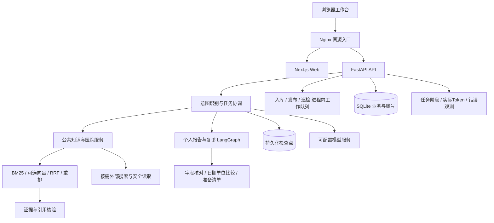

# 复诊健康咨询agent · CareBrief

面向患者与家属的复诊准备、报告问答与就医信息工作台。基于 Next.js、FastAPI 和 LangGraph，支持公共知识检索、引用核验、资料核对、任务追踪与检查点恢复。

仓库：https://github.com/jamezhuang/followup-health-agent

## 一眼看懂

| 能力 | 实现 |
|---|---|
| 分场景处理 | 日常问答、健康科普、医院服务与个人复诊任务按意图进入对应流程 |
| 有依据的回答 | BM25、可选向量召回与RRF融合、可选模型重排、有限检索补充与引用核验 |
| 个人资料管理 | 报告上传、字段人工核对、按用户与复诊对象隔离、实际日期和单位比较 |
| 公共知识维护 | 批量入库、草稿审核、发布/撤回、版本冲突校验、网页更新巡检 |
| 可观测与可恢复 | run_id关联阶段与模型调用，统计实际Token、错误及重试，符合条件时恢复检查点 |

## 快速启动（Docker Compose）

需要 Docker Engine 与 Compose。默认demo模式，无模型密钥也能启动，不会伪造真实模型调用记录。

```bash
git clone https://github.com/jamezhuang/followup-health-agent.git
cd followup-health-agent
cp .env.example .env
docker compose up -d --build --wait
```

Windows PowerShell用 `Copy-Item .env.example .env` 替代cp。访问 http://localhost:8080/workspace ，API文档位于 http://localhost:8080/api/docs 。

首次可注册普通用户。创建管理员：

```bash
docker compose exec api python -m app.account_admin admin001 --role admin --generate-password
```

输出的密码自行保管，不提交仓库。没有预置账号、患者报告或业务数据库。真实模型需在本机 `.env` 填入自己的凭据，设置 `PROVIDER_MODE=live` 后重建API容器。细节见[部署指南](docs/deployment.md)。

## 系统架构




## 可复现实验

| 实验 | 已记录结果 | 样本与设置 |
|---|---|---|
| 意图优化 | 严格匹配94/100→99/100；后续意图Token减少17.9% | 固定开发集，不同阶段实验 |
| 检索对照 | BM25证据组R@3 83.3%→混合检索加模型重排99.4% | 55条有答案的合成检索题 |
| 检查点成本 | 模型请求5→3，总Token195→115 | 单次三阶段组件故障恢复对照 |
| 工程验收 | 60项定向检查、47项相关回归通过 | 定向检查与回归覆盖存在重叠 |

实验方法、样本范围与完整结果见[检索报告](apps/api/data/agent_eval_v2/EXPERIMENT_REPORT.md)、[优化复测](apps/api/data/agent_eval_v2/OPTIMIZATION_ROUND2_REPORT.md)及[五项工程量化](docs/reliability-quantification-2026-10-19.md)。以上为固定测试场景下的结果，不代表生产环境总体准确率或临床验证。

## 后续开发完善方向

| 方向 | 开发重点 |
|---|---|
| 回答质量与知识覆盖 | 精简提示词、完善复合问题覆盖、扩大跨省官方来源及真实脱敏评测 |
| 服务并发与中间件 | 按需接入MySQL、Redis和MQ，完善幂等、事务、限流、锁与故障恢复 |
| 全链路观测与成本治理 | 统一Trace ID与Span，扩大真实工作流恢复量化，增加预算及费用统计 |
| 知识运营 | 定时巡检、变化分级、审核提醒及历史数据归档 |
| 平台与部署 | Coze真实联调、独立服务部署、HTTPS和备份恢复演练 |

具体优先级、实施内容与验证指标统一维护在[后续开发完善方向](docs/roadmap.md)。这些是后续计划，当前能力和实测结果见上文。

## 文档与验证

- [部署与持久化](docs/deployment.md)
- [知识库生命周期](docs/public-knowledge-lifecycle.md)
- [任务查询与消耗](docs/task-lookup-and-usage.md)
- [资料更新巡检](docs/knowledge-source-inspections.md)
- [公共回答引用](docs/public-answer-citations.md)
- [Coze工作流接口与接入说明](docs/coze-workflow-integration.md)
- [系统设计](ARCHITECTURE.md)
- [公共资料信源规则](docs/公共资料信源使用须知.md)

GitHub Actions执行隔离后端回归、前端构建、容器构建和启动健康检查，不使用生产密钥。医疗内容用于就医指引、资料整理与科普，不提供诊断或处方。MIT许可适用于项目源码，外部资料与引用内容保留各自权利。
