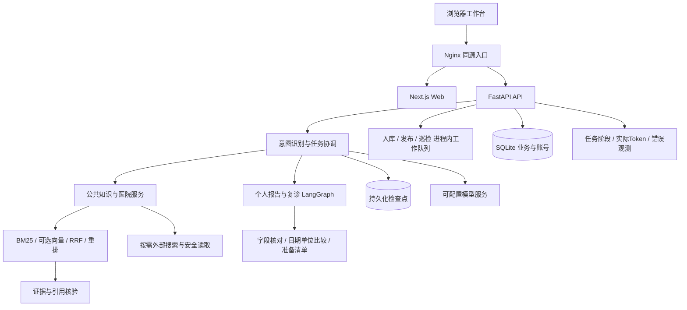

# 复诊健康咨询agent · CareBrief

面向患者与家属的复诊准备、报告问答与就医信息工作台。基于 Next.js、FastAPI 和 LangGraph，支持公共知识检索、引用核验、资料核对、任务追踪与检查点恢复。

仓库：https://github.com/jamezhuang/followup-health-agent

## 一眼看懂

| 能力 | 实现 |
|---|---|
| 分场景处理 | 日常问答、健康科普、医院服务与个人复诊任务按意图进入对应流程 |
| 有依据的回答 | BM25、可选向量召回与RRF融合、可选模型重排、有限检索补充与引用核验 |
| 个人资料管理 | 报告上传、字段人工核对、按用户与复诊对象隔离、实际日期和单位比较 |
| 公共知识维护 | 批量入库、草稿审核、发布/撤回、版本冲突校验、网页更新巡检 |
| 可观测与可恢复 | run_id关联阶段与模型调用，统计实际Token、错误及重试，符合条件时恢复检查点 |

## 快速启动（Docker Compose）

需要 Docker Engine 与 Compose。默认demo模式，无模型密钥也能启动，不会伪造真实模型调用记录。

```bash
git clone https://github.com/jamezhuang/followup-health-agent.git
cd followup-health-agent
cp .env.example .env
docker compose up -d --build --wait
```

Windows PowerShell用 `Copy-Item .env.example .env` 替代cp。访问 http://localhost:8080/workspace ，API文档位于 http://localhost:8080/api/docs 。

首次可注册普通用户。创建管理员：

```bash
docker compose exec api python -m app.account_admin admin001 --role admin --generate-password
```

输出的密码自行保管，不提交仓库。没有预置账号、患者报告或业务数据库。真实模型需在本机 `.env` 填入自己的凭据，设置 `PROVIDER_MODE=live` 后重建API容器。细节见[部署指南](docs/deployment.md)。

## 系统架构



部署配置参考了 [Adaptive-rag](https://github.com/JEen-wang/Adaptive-rag) 的容器化、健康检查和文档组织方式，具体业务与存储按本项目实现。当前不依赖Redis、MQ、MySQL或Qdrant；没有把它们画成已接入组件。SQLite与进程内队列要求API单worker；GitHub存放源码，在线服务仍需独立服务器。

## 可复现实验

| 实验 | 已记录结果 | 边界 |
|---|---|---|
| 意图优化 | 严格匹配94/100→99/100；后续意图Token减少17.9% | 固定开发集，不同阶段实验 |
| 检索对照 | BM25证据组R@3 83.3%→混合检索加模型重排99.4% | 55条有答案合成题，非真实医院准确率 |
| 检查点成本 | 模型请求5→3，总Token195→115 | 单次三阶段组件微基准，非普遍节省率 |
| 工程验收 | 60项定向检查、47项相关回归通过 | 存在重叠，非107个独立场景或生产可靠率 |

实验方法、样本范围与完整结果见[检索报告](apps/api/data/agent_eval_v2/EXPERIMENT_REPORT.md)、[优化复测](apps/api/data/agent_eval_v2/OPTIMIZATION_ROUND2_REPORT.md)及[五项工程量化](docs/reliability-quantification-2026-10-19.md)。以上为固定测试场景下的结果，不代表生产环境总体准确率或临床验证。

## 文档与验证

- [部署与持久化](docs/deployment.md)
- [知识库生命周期](docs/public-knowledge-lifecycle.md)
- [任务查询与消耗](docs/task-lookup-and-usage.md)
- [资料更新巡检](docs/knowledge-source-inspections.md)
- [公共回答引用](docs/public-answer-citations.md)
- [Coze接入准备](docs/coze-workflow-integration.md)：接口已实现，平台联调未完成。

GitHub Actions执行隔离后端回归、前端构建、容器构建和启动健康检查，不使用生产密钥。医疗内容用于就医指引、资料整理与科普，不提供诊断或处方。MIT许可适用于项目源码，外部资料与引用内容保留各自权利。

以下为本地开发与历史实现说明；仅供开发参考，不包含可复用的业务账号或私有数据。

---

独立开发目录。复用 V1 工作台资产和部分基础模块；账号、私有报告、业务数据库独立保存。
本机联调已复用现有供应商连接，密钥只保存在本机被忽略的 `.env` 中，不写入源码与日志。

公共资料的来源优先级、第三方参考限制及时效核对规则见[公共资料信源使用须知](docs/公共资料信源使用须知.md)。

## 启动

运行 `Start-Api.ps1` 和 `Start-Web.ps1`，访问 http://127.0.0.1:3002/workspace 。
后端为 http://127.0.0.1:8002 ，交互式接口文档位于 `/docs`。

示例配置默认演示模式：规则整理个人记录，不调用模型，不生成虚假的调用日志。本机已配置真实模型模式。
部署不会自动创建账号，运行数据留在本机或持久化卷中。
普通用户可在页面注册；管理员只能通过本地命令创建：

```powershell
cd apps/api
.venv/Scripts/python.exe -m app.account_admin admin001 --role admin --generate-password
```

账号和密码均为 6–20 位字母或数字，允许纯数字、纯字母。管理员和普通用户使用相同登录页。

## 真实模型

复制 `apps/api/.env.example` 为 `.env`，填写自己的模型配置并将 `PROVIDER_MODE` 改为 `live` 后重启 API。
Embedding 配置可选；没有配置或文档尚未向量化时明确降级为 BM25 检索。
不提交 `.env`，不在网页或日志中暴露密钥。数据库在 `apps/api/.cache` 下独立保存。

## 当前服务流程

管理员故障定位已接入持久化阶段检查点：后台管理 → 运行观测 → 任务链路可查看答复结果、定位阶段、检索损耗，并对符合条件的新任务从检查点恢复。每个任务最多手动恢复两次；旧任务、已变化的资料或已有后续对话不直接重放。详见 [管理员故障定位与检查点恢复](docs/管理员故障定位与检查点恢复.md)。

入口仅有两个主分支：`daily`为日常交流、健康科普与就医咨询，内部按需使用公共知识检索或医院搜索；`followup`为个人报告问答、复诊信息归档、调取和按需准备清单。癌症、化疗、地区医院名录、疾病/损伤/手术方向选院均可进入日常咨询；没有创建复诊对象也可咨询或上传。医院等动态事实仍须检索核实，不保证任何问题都能得到完整名单。

上传默认只用于对话；明确请求归档时引导已有核对确认流程，不通过聊天静默保存。调取仅访问当前账号、当前对象的已确认资料；没有选对象时不跨对象猜测。只有明确要求复诊清单时才生成清单，未归档也可给一般准备提醒。

面向一个子女账号管理多位家人的慢病复诊准备。普通客户端只展示输入、关键字段核对、业务进度、结果及可核查依据，不展示分块、检索词、重排或反思过程。

1. 可先日常咨询或上传报告，无需预先建立家人档案；家人资料和对话按归属隔离。
2. 在对话输入框左下角“＋”上传检查报告、复诊病历或处方，支持多文件。读取后直接提问；需要归档时再选择已有对象或核对新对象信息，并打开报告关键字段核对窗口。
3. 核对患者姓名、实际日期、检查值、单位、参考范围和药品资料；识别不确定的内容可留空。单位建议由用户选用，不静默补成报告事实。
4. 可以保存草稿、稍后恢复；确认后原文件、报告、检查记录、可选当前信息版本和医嘱待办原子写入。重复确认不会重复入档。
5. 报告在“历史报告与更新记录”中按录入时间保留；实际检查日期用于对比。缺少实际日期的报告仍可归档，但不生成按日期排列的检查记录。
6. 对话可要求比较明确日期/项目，或准备一次复诊；可导出摘要、查看依据、评价或重新生成。普通科普默认不读取个人档案。
7. 医生明确交代的事项可在报告核对时选择保存为待办，支持完成、取消和恢复；暂不发送外部提醒。

## 当前实现范围

- 四路意图：日常事务、医药科普、医院服务、个体化复诊；固定问候/指引无需调用模型。复合意图可包含医院查询。
- LangGraph 复诊编排，时间线和检索并行，独立子任务上下文；BM25 + 可选向量 + RRF，受控别名扩展、结构感知切分、父上下文展开、可选模型重排、有限检索反思和逐项引用核验。
- 报告关键字段提取使用可观测结构化模型调用；失败时退回保守规则并保留人工补充入口。患者更正后的关键字段进入后续检索，不用识别正文覆盖更正。
- Decimal 数值比较仅用于同项目、同单位、不同实际日期；同日冲突不任意选取。不推断数值变化的医学原因，不生成调药方案。
- 会话上下文按预算进行三级收缩，保存早期用户约束、决定和未决事项；过大时要求限定范围。调用前计数是UTF-8字节上界估算，不冒充供应商精确Token数；真实账单用量另行记录。
- SQLite 增量迁移，新增确认与报告事件数据；旧账号、报告和接口兼容。升级前备份位于忽略的 `.cache/backups/`。
- 模型每次HTTP尝试记录用途、输入/输出/总Token、耗时、成败和脱敏失败原因。未知用量保持未知；管理员才能查看明细。

## 资料覆盖与外部能力

已收录第一批国家卫健委官方食养资料（5份、44页），主要用于高血压、糖尿病、血脂异常、痛风相关食养解释，不等同于完整慢病复诊或药物指南；甲状腺等资料仍需补充。

腾讯云OCR/ASR适配器已预留，默认关闭，需配置凭据并安装 `requirements-tencent.txt`；不代表已验证真实识别质量。医院官方查询复用受限域名检索适配器，需要启用 `EXTERNAL_SEARCH_ENABLED` 并配置搜索服务；无可核实来源时不生成排班、号源或费用。

当前复诊图的计算任务仍在进程内执行，服务重启会标为中断，不自动重跑；报告核对草稿是独立持久状态，可跨刷新和重启恢复。尚未部署图数据库、多模态向量检索、自由Text2SQL、家庭多账号共享和提醒渠道。

医院公共查询区分地区医院名录、具体机构和通用服务，覆盖位置院区、科室、挂号、交通、医生、时间、医保等问题。多轮追问沿用最近医院范围，切换地区重新检索；上传报告不妨碍切换到公共医院咨询。先读取搜索候选的正文，失败或缺少所问内容时尝试已启用的浏览器；无结果或覆盖不全时改写关键词，并可切换已配置的搜索服务。候选摘要、空文档查看器和仅有目录标题的页面不作为医院名单证据。

地区名单使用统一层级策略：省级/全国默认8–10家，城市5–8家，区县4–6家，通常至少争取4家；用户明确要求少量条目时尊重其数量。覆盖不足时按预算补查实际分页/附件/详情链接，再改写查询，不擅自放宽地区和筛选条件。生成后可进行一次漏列检查。数量是证据覆盖目标，不是医院总数或编造配额；明确询问总数时改查统计来源。只补充城市的追问重新确定地区范围，不限定为上一轮已列医院。

本地公共知识已从5份扩展到16份，新增11份跨主题资料，包含影像检查、报告阅读、肺结节科普、用药安全、异地医保、检查结果互认、健康素养和官方医院名录快照。准备、发布和检索检查见 [第二批资料说明](apps/api/data/official_batch_02/README.md)。通用公共资料允许不选择病种，动态目录分别保存采集日期和发布日期；医院查询先利用已发布本地资料，再联网补充或刷新。框架对照与限制见 [检索流程审阅](docs/retrieval-framework-review.md)。

查询通过现有搜索服务配置运行，无需额外密钥。可用环境变量限定每次查询：`HOSPITAL_SEARCH_MAX_ROUNDS=3`（1–3轮）、`HOSPITAL_PAGE_LIMIT=8`（1–12个直接读取页面）、`HOSPITAL_BROWSER_LIMIT=2`（0–3次浏览器读取）、`HOSPITAL_LOOKUP_TIMEOUT=75`（1–120秒，检索总时限，不含模型生成）。只发送公开机构和服务查询信息；保留部分成功结果，分别说明服务故障、页面不可读、未找到资料和信息不完整。省级名单默认标为部分名单，不承诺穷尽或实时号源。

## 验证

疾病相关选院需要逐院读取科室资料，另按覆盖目标分配页面预算：`HOSPITAL_SERVICE_PAGE_LIMIT=16`（可配1—24），与普通基础预算取较大者，并受目标数量与总时间限制。可从搜索结果发现机构后分别补查，最多8次机构搜索；排名/就诊攻略不直接作为专科优势证据。

已接入参考框架中适用的查询改写/拆分、资料充分性路由和回答事实核对。医院查询保留服务端范围校验和读取预算；一般科普先检索已发布知识，再按缺口有界联网；报告问答优先用户核对字段。核对失败最多修正一次并复核，仍未通过则保留原文证据。`RAG_PROMPT_PIPELINE_ENABLED=true`默认启用，可关闭以排查新增阶段。实际接入范围、超时和真实调用证据见 [提示词接入记录](docs/reference-medical-rag/接入记录.md)。

```powershell
cd apps/api
.venv/Scripts/python.exe -m pytest tests/test_v2_followup.py -q
cd ../web
npm.cmd run build
```

V1 的兼容源码和测试保留以便复用，但 V2 的运行入口是 `app.v2_main:app`，前端入口是 `WorkspaceV2Client.tsx`。

浏览器测试见 `e2e/review-workflow.spec.ts` 等：测试配置自动启动8003端口的独立合成数据后端，上传/模型提取测试使用替身，绝不把它们计为真实模型调用。页面仍需启动3002端口；部分既有账号/后台测试使用8002端口，测试对象均为临时虚构资料。

真实长对话约束验收：`python -X utf8 scripts/check_context_memory.py`，需要现有模型配置，会产生一次真实模型调用；结果写入忽略的 `.cache/context-acceptance.json`。
